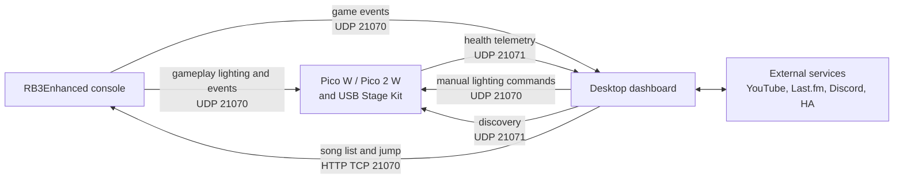

# Dashboard architecture

This document describes the desktop dashboard at the end of the Stage 1 refactor. Stage 1 separates reusable services from Tk presentation while preserving the existing desktop entry point, settings and caches, LAN packet bytes, and user controls. It does not provide a headless server, web dashboard, container, or Home Assistant entity integration; those remain Stage 2 work.

Stage 1 is complete at application-source commit `f5133bb`. The full test suite, three real-Tk fake-I/O smokes, scoped final review, Windows PyInstaller build, and archive inspection all passed. Documentation revisions are recorded in Git history.

## Runtime topology



The console sends gameplay lighting directly to each Pico. The dashboard observes the same game events and manages discovery, telemetry, manual test commands, media, history, and integrations. Gameplay lighting does not need the dashboard as a proxy.

| Port | Transport | Current traffic |
| --- | --- | --- |
| `21070` | UDP | Console game and Stage Kit events to the dashboard and Picos; dashboard manual Stage Kit commands to a selected Pico or broadcast address. |
| `21071` | UDP | Dashboard discovery broadcasts to Picos; Pico USB, signal, and device telemetry back to the dashboard. |
| `21070` | TCP/HTTP | Dashboard requests the console song list, sends song-jump requests, and opens the console's existing web UI. |

## Module responsibilities

| Module | Responsibility |
| --- | --- |
| `Dashboard/dashboard.py` | Stable source entry point, explicit dependency check, public compatibility re-exports, and `main()`. It creates no UI when imported. |
| `rb3dashboard.protocol` | Port and RB3E wire constants plus datagram validation. |
| `rb3dashboard.listener` | UDP game-event receive lifecycle, validated console detection, song/game state, video request coordination, and existing Home Assistant webhook dispatch. It has no Tk imports. |
| `rb3dashboard.stagekit` | Stage Kit command socket, discovery broadcasts, recursive-input-safe telemetry validation, isolated logging, and transport teardown. It has no UI ownership. |
| `rb3dashboard.song_browser` | Console HTTP song-list and jump client, strict INI parsing, indexes, and atomically replaced JSON cache. Failed or invalid loads preserve accepted state. |
| `rb3dashboard.album_art` | Last.fm artwork lookup, in-memory LRU, SQLite cache, request deduplication, and owner-thread image delivery. |
| `rb3dashboard.settings` | Defaults, input validation, compatible path selection, invalid-file preservation, and atomic JSON saves. |
| `rb3dashboard.song_data` | Local song database lookup, in-memory/exportable session history, and persistent play statistics. |
| `rb3dashboard.video` | YouTube selection, stream extraction, and VLC discovery/playback. |
| `rb3dashboard.integrations` | Last.fm API client and Discord Rich Presence client, independent of Tk. |
| `rb3dashboard.dispatch` | Worker-to-owner callback queue. Tk drains at most 100 callbacks every 20 ms by default; the deque itself is not capacity-bounded. |
| `rb3dashboard.desktop.app` | Tk composition root and application lifecycle. It owns session generations, timers, service construction, start/stop, and teardown. |
| `rb3dashboard.desktop.integrations` | One sequential desktop-owned worker for Last.fm and Discord operations, including Discord cleanup on the same owner thread. |
| `rb3dashboard.desktop.browser`, `history`, `stagekit`, `settings`, `activity`, `log`, `theme` | Focused Tk view mixins. They render and collect user input while delegating persistence, networking, and media work to services. |

The original `Dashboard/dashboard.py` contained 4,447 lines at `7104032`; the current compatibility entry point contains 63. Desktop composition is 435 lines, and the largest view module is settings at 419 lines. These counts describe `f5133bb`.

## Ownership and lifecycle

| Owner | Work it performs | Delivery and shutdown boundary |
| --- | --- | --- |
| Tk main thread | Widgets, `PhotoImage`, timers, accepted browser state, history/statistics updates, and application lifecycle. | `UiDispatcher` delivers worker results on this thread. Session, browser, artwork, integration, and scrobble generations reject stale callbacks. |
| Listener receiver | Binds UDP `21070`, validates packets, and derives game/session events. | `stop()` invalidates a reserved or active run and closes its socket. The UI does not join this thread. |
| Stage Kit telemetry worker | Broadcasts discovery and receives validated telemetry on UDP `21071`. | `StageKitTransport` owns both UDP sockets; stop closes them before a bounded worker join. |
| Video lookup worker | Searches and extracts one active request while retaining only the latest waiting request. | Generation and cancellation checks discard stale results and stop a VLC process that finishes launching after cancellation. An in-flight external lookup may still finish. |
| Album-art worker | Performs Last.fm/image HTTP and SQLite cache work. | Images and callbacks return through the owner scheduler. Close rejects deliveries and clears waiting work without waiting for HTTP timeout. |
| Desktop integration worker | Serializes Last.fm and all Discord RPC operations. | Stop drops queued session work and schedules Discord cleanup; close returns immediately and cleanup follows any in-flight call. |
| HA webhook workers | Send individual JSON webhook posts with a two-second timeout. | Per-event daemon threads keep HTTP out of the UDP receiver; there is no durable ordering, retry, or delivery record. |

`RB3Dashboard.run()` schedules listening automatically shortly after Tk starts. The **Log** tab displays listener status but has no Start/Stop controls in the current UI. Closing the window invalidates pending callbacks and timers before closing desktop-owned services and destroying Tk.

## Preserved data paths and formats

The refactor deliberately retains the existing file names and formats. It does not introduce a unified server data directory.

| Data | Preferred path | Fallback and behavior |
| --- | --- | --- |
| Settings JSON | `%APPDATA%\RB3Dashboard\settings.json` when `APPDATA` exists. | `~/.rb3dashboard/settings.json`, then `rb3_dashboard_settings.json` in the working directory if directories cannot be created. Saves are atomic; malformed input is preserved before replacement. |
| Play statistics JSON | `%APPDATA%\RB3Dashboard\play_stats.json` when `APPDATA` exists. | `~/.rb3dashboard/play_stats.json`, then `Dashboard/play_stats.json`. Invalid readable bytes are preserved as `play_stats.json.invalid-*.bak` before a new save; an unreadable file disables saving for that session. |
| Album-art SQLite cache | `%APPDATA%\RB3Dashboard\album_art.db` when `APPDATA` exists. | `~/.rb3dashboard/album_art.db`; disk caching is disabled if neither path can be prepared. |
| Song-list JSON cache | `%APPDATA%\RB3Dashboard\song_list_cache.json` on Windows with `APPDATA`. | `~/.rb3dashboard/song_list_cache.json` otherwise. A new desktop fetch is persisted only after its current session/generation accepts it. |
| Song metadata database | User-selected source file; its path is retained in settings. | Invalid imports leave the loaded database, count, and path unchanged. |
| Session history | Memory for the current process. | CSV or JSON goes only to the destination selected by the user. |

## Supported commands

Run these from the repository root unless the command changes directory:

```powershell
python -m pip install -r Dashboard/requirements.txt
python Dashboard/dashboard.py

cd Dashboard
python -m unittest discover -s tests -v
python -m PyInstaller --noconfirm dashboard.spec
python tools/check_stage1_archive.py
```

The application reports missing required packages at startup and never installs them during import. The test suite uses fake network, media, Discord, and device dependencies. The tracked archive checker verifies that every Python module under `rb3dashboard` is present in the built executable's PYZ archive. The three real-Tk smoke scripts cited below were local audit helpers and are validation provenance, not supported commands shipped in a fresh checkout.

## Stage 1 commit record

Stage 1 starts after baseline `7104032` and currently contains these code commits:

| Commit | Change |
| --- | --- |
| `831f05d` | Extract RB3E listener and add baseline tests. |
| `f1feb90` | Validate RB3E packets before console detection. |
| `afdd5ff` | Cancel stale video playback when songs end. |
| `cbb2ca4` | Move video lookups off the packet receiver. |
| `b4aedbb` | Extract dashboard video services. |
| `9be604b` | Extract song data and statistics. |
| `61f7ade` | Validate song imports and saved statistics. |
| `2e397cb` | Extract Last.fm and Discord integrations. |
| `8872f54` | Preserve Discord menu state across reconnects. |
| `1c2574b` | Extract the console song-browser client. |
| `8a0fa21` | Preserve song-browser state on invalid responses. |
| `d163c62` | Extract album-art services. |
| `112c340` | Deliver artwork results on the UI thread. |
| `45aed12` | Isolate Stage Kit network transport. |
| `e2409c5` | Isolate dashboard settings and startup. |
| `0e84e01` | Split desktop presentation into focused views. |
| `41bfc8d` | Invalidate stale desktop callbacks on shutdown. |
| `ae75201` | Cancel stale VLC process launches while preserving the auto-quit setting. |
| `84dd57a` | Preserve song lists and caches on failed or malformed loads. |
| `3945fc0` | Recover from malformed Stage Kit telemetry and correct command logging. |
| `f5133bb` | Ship reproducible archive verification and remove the unused `littlefs` packaging dependency. |

This table records the Stage 1 dashboard application commits; documentation revisions are recorded in Git history.

The final audit added regression coverage for VLC processes that finish launching after cancellation, including the existing `auto_quit_on_menu=False` behavior. It also made song-cache replacement atomic and failure reporting truthful, rejected malformed HTTP/cache song data without replacing valid state, recovered from deeply nested telemetry, isolated failing transport log callbacks, corrected displayed Stage Kit command bytes, and removed the unused `littlefs-python` build dependency. Scoped re-review approved these corrections.

## Validation and limits

At `f5133bb`, the coordinator ran `python -m unittest discover -s tests -q` with Python 3.11.0 on Windows: **209 tests passed in 12.434 seconds**. The three local real-Tk smoke programs also passed with fake I/O: desktop lifecycle, artwork delivery, and Stage Kit transport. Earlier task reviews also checked Python 3.8 grammar, import side effects, callback ownership, teardown, persistence failure cases, and preserved desktop methods. The final scoped review approved all audit fixes.

The final Windows build used PyInstaller 6.18.0 with hooks 2026.0 and completed successfully in about 38 seconds. It produced `Dashboard/dist/RB3E-Dashboard.exe` at 54,537,211 bytes. `python tools/check_stage1_archive.py` then passed and found all 21 application modules in the executable's PYZ archive. Retained warnings reported that `urllib3.contrib.emscripten` could not import `js`, and that data collection skipped `curl_cffi` and `yt_dlp_ejs` because they were not packages in this environment; the build had no error lines.

The executable itself was not launched. This evidence does not include real console/Pico hardware, live network or video services, Discord IPC, VLC playback, Linux, Docker, or Unraid runtime validation.

Known behavior that remains:

- Last.fm submits `time.time()` when scrobbling rather than the stored track start time. Its desktop timer does not enforce Last.fm's minimum track-duration rule, and failure/ignored responses are not reliably distinguished from success. A protocol follow-up should align with the official [`track.scrobble`](https://www.last.fm/api/show/track.scrobble) and [scrobbling](https://www.last.fm/api/scrobbling) guidance.
- Discord Rich Presence uses `pypresence` and the local Discord client's IPC pipe. A process running only on a remote Unraid host cannot update a separate PC client through that local pipe; a desktop companion is the likely design. See the official [Discord RPC documentation](https://docs.discord.com/developers/topics/rpc) and [`pypresence.Presence`](https://qwertyquerty.github.io/pypresence/html/doc/presence.html) ownership documentation.
- The desktop infers one `/24` subnet broadcast from its default route. Each Pico remembers one dashboard discovery address, so competing dashboards can redirect telemetry. Multi-interface discovery and authoritative ownership remain Stage 2 decisions.
- In-flight HTTP/RPC calls cannot be forcibly canceled. Queue invalidation prevents stale UI publication, but process exit can end daemon work before application-level cleanup finishes.
- Manual console song-jump requests, Last.fm authorization, some VLC launch/stop paths, and substantial tree/disk operations can still wait synchronously on their caller.
- The UI dispatch deque and desktop integration queue have no fixed capacity. UI draining is limited per tick, but backpressure, coalescing, durable retries, and observability are not implemented.
- A blocked integration operation can finish in a later session and place its completion message in that session's log. Generation checks still prevent stale status and gameplay state changes.

Accepted maintenance follow-ups are additional test coverage for the album-art temporary-home fallback, formatting between mechanically moved desktop methods, and assertions around expected invalid-settings diagnostics. They are not known functional failures.

## Stage 2 direction and opportunities

Stage 2 should establish one headless service as the authoritative listener and Pico discovery owner. Desktop and web clients can consume its state and issue management commands while the direct console-to-Pico gameplay path remains intact. Define explicit bind/broadcast interfaces, lifecycle supervision, queue capacity/backpressure, event streaming, authentication, and a persistent session model before exposing an API.

For an Unraid prototype, Docker host networking is a reasonable candidate because it shares the host network namespace, but UDP broadcast and interface selection still require testing on the actual server. Persist service data in an Unraid appdata mapping and make every bind, broadcast, and advertised address explicit. Docker documents the [host network driver](https://docs.docker.com/engine/network/drivers/host/), and Unraid documents [network modes and persistent appdata](https://docs.unraid.net/unraid-os/using-unraid-to/run-docker-containers/managing-and-customizing-containers/). Stage 1 contains no container and makes no Unraid compatibility claim.

| Opportunity | Useful first slice |
| --- | --- |
| Shared party dashboard | Phone/tablet controls, now-playing state, scores, device health, and persistent session history from the authoritative service. |
| Browser and OBS overlays | Read-only kiosk/overlay views with reconnecting event streams and scoped tokens. |
| Event recording and replay | Timestamp validated console events so bugs and UI behavior can be reproduced without live hardware. |
| Lighting scenes and fleet health | Named test scenes plus per-device USB, RSSI, last-seen, and availability state, while leaving gameplay broadcasts direct. |
| Home Assistant | Publish game/session/device sensors, events, buttons, and availability through a configured broker using [MQTT discovery](https://www.home-assistant.io/integrations/mqtt/#mqtt-discovery), with explicit ownership and restore behavior. The existing webhook can remain a simple option. |
| Local companions | Keep VLC/display and Discord IPC near the user's PC while the Unraid service owns shared LAN/session state. |
