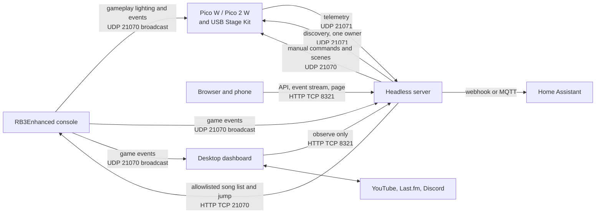

# Dashboard architecture

This document describes the dashboard after Stage 2. There are now two programs.

The **desktop application** is unchanged in how it is launched and used. Stage 1 separated its reusable services from Tk presentation while preserving the entry point, settings and caches, LAN packet bytes, and user controls. Stage 1 is complete at application-source commit `f5133bb`.

The **headless server** runs the same reusable services with no Tk at all, adds an HTTP API, an event stream, a browser dashboard, session history, and Home Assistant integration, and can own Pico discovery. Stage 2 is complete at `d7a36eb`. It is started with `python Dashboard/rb3server.py` and is packaged as a container that has never been built or run; see [deployment](deployment.md).

Gameplay lighting travels from the console directly to each Pico in both arrangements. Neither program is ever in that path.

## Runtime topology



The console sends gameplay lighting directly to each Pico. Both programs observe the same game events. Discovery, telemetry, manual test commands, and shared session state belong to whichever program owns them; media, Discord, and displays stay on the desktop.

| Port | Transport | Current traffic |
| --- | --- | --- |
| `21070` | UDP | Console game and Stage Kit events to the dashboard and Picos; dashboard manual Stage Kit commands to a selected Pico or broadcast address. |
| `21071` | UDP | Dashboard discovery broadcasts to Picos; Pico USB, signal, and device telemetry back to the dashboard. |
| `21070` | TCP/HTTP | Dashboard requests the console song list, sends song-jump requests, and opens the console's existing web UI. |

## Upstream protocol findings

Verified against the RB3Enhanced source in September 2026. These facts shaped several Stage 2 decisions, so they are recorded here rather than left in a plan.

| Finding | Source | Consequence |
| --- | --- | --- |
| `RB3E_InitEvents()` defaults to `EventsIP = 255.255.255.255` and `EventsPort = 0x524E`, which is 21070. | `source/net_events.c` | Events are broadcast, so the server is additive: it can listen alongside the desktop and the Picos without changing console configuration. |
| `[Events] BroadcastTarget` replaces both address and port with a single destination. | `source/net_events.c`, `include/config.h` | Setting it silences every other receiver. Pointing it at the server would stop gameplay lighting reaching the Picos. It must stay empty or hold a broadcast address. `relay_targets` exists for deployments that have already set it. |
| `[Events] SendStagekit` is a separate flag from `EnableEvents`. | `include/config.h` | Stage Kit events need their own opt-in. Without it the console sends no lighting at all, which looks like dead Picos. |
| `[HTTP] AllowCORS` is zero-initialised and therefore off. | `include/config.h`, `source/config.c` | A browser cannot call the console directly. The server proxies the song list and song jump; that is the only way the page can reach them. |
| The console serves `/`, `/song_<id>`, `/list_songs`, `/jump`, `/jsonrpc` and `/execute`. | `source/net_http_server.c` | `/execute` runs DTA script on the console. The proxy is an explicit two-route allowlist and never builds a console path from a request. |
| The event enum is unvalued and sequential 0-10. `SCORE` is 21 bytes, `STAGEKIT` 2, `BAND_INFO` 12, and `DX_DATA` is `RB3E_EventModData`: a 10-byte identify value and a string of up to 240. | `include/net_events.h` | `rb3dashboard.protocol` was correct except that mod data was missing and therefore discarded. Only the identify value is required, because the sender chooses how much it transmits. |
| `PacketSize` is a single byte. | `include/net_events.h` | The existing `>IBBBB` header unpack is right. |

Multi-byte fields are big-endian because the console targets are PowerPC. This matches the existing parser and is unverified for any x86 path.

## Firmware behaviour that constrains the design

`firmware/src/network.c` stores exactly one `dashboard_addr`. It overwrites that address on every discovery packet it receives, unicasts telemetry there, and reverts to broadcasting only after `DISCOVERY_TIMEOUT_MS`, which is 30 seconds, without hearing discovery.

Two programs broadcasting discovery therefore make every Pico alternate between them every few seconds, and neither holds a stable device list. Exactly one owner is allowed. That single fact is why the server's Stage Kit support is off by default, why discovery can be enabled separately from telemetry reception, why losing a device while owning discovery logs a specific warning, and why the desktop has an observe-only mode at all.

## Module responsibilities

| Module | Responsibility |
| --- | --- |
| `Dashboard/dashboard.py` | Stable source entry point, explicit dependency check, public compatibility re-exports, and `main()`. It creates no UI when imported. |
| `rb3dashboard.protocol` | Port and RB3E wire constants plus datagram validation. |
| `rb3dashboard.listener` | UDP game-event receive lifecycle, validated console detection, song/game state, video request coordination, and existing Home Assistant webhook dispatch. It has no Tk imports. |
| `rb3dashboard.stagekit` | Stage Kit command socket, discovery broadcasts, recursive-input-safe telemetry validation, isolated logging, and transport teardown. It has no UI ownership. |
| `rb3dashboard.song_browser` | Console HTTP song-list and jump client, strict INI parsing, indexes, and atomically replaced JSON cache. Failed or invalid loads preserve accepted state. |
| `rb3dashboard.album_art` | Last.fm artwork lookup, in-memory LRU, SQLite cache, request deduplication, and owner-thread image delivery. |
| `rb3dashboard.settings` | Defaults, input validation, compatible path selection, invalid-file preservation, and atomic JSON saves. |
| `rb3dashboard.song_data` | Local song database lookup, in-memory/exportable session history, and persistent play statistics. |
| `rb3dashboard.video` | YouTube selection, stream extraction, and VLC discovery/playback. |
| `rb3dashboard.integrations` | Last.fm API client and Discord Rich Presence client, independent of Tk. |
| `rb3dashboard.dispatch` | Worker-to-owner callback queue. Tk drains at most 100 callbacks every 20 ms by default; the deque itself is not capacity-bounded. |
| `rb3dashboard.desktop.app` | Tk composition root and application lifecycle. It owns session generations, timers, service construction, start/stop, and teardown. |
| `rb3dashboard.desktop.integrations` | One sequential desktop-owned worker for Last.fm and Discord operations, including Discord cleanup on the same owner thread. |
| `rb3dashboard.desktop.browser`, `history`, `stagekit`, `settings`, `activity`, `log`, `theme` | Focused Tk view mixins. They render and collect user input while delegating persistence, networking, and media work to services. |

The original `Dashboard/dashboard.py` contained 4,447 lines at `7104032`; the current compatibility entry point contains 63. Desktop composition is 435 lines, and the largest view module is settings at 419 lines. These counts describe `f5133bb`.

## Server module responsibilities

Everything under `rb3dashboard.runtime` is server-side and imports no Tk, VLC, Discord, display, or MQTT dependency at module level. A test walks the whole package and enforces that.

| Module | Responsibility |
| --- | --- |
| `Dashboard/rb3server.py` | Entry point. Loads configuration, installs signal handlers, runs until asked to stop, and reports configuration problems as messages rather than tracebacks. |
| `runtime.supervisor` | Ordered start and reverse-order stop. A failed start rolls back its predecessors and re-raises; a failing stop is isolated so the rest still release. |
| `runtime.server` | Composition root. Owns the listener, optional transport, relay, history, outbound worker, MQTT, web service, and a maintenance tick. |
| `runtime.dispatch` | Bounded worker-to-owner queue with counted drops, discards and refusals. The headless counterpart to `UiDispatcher`. |
| `runtime.state` | Shared game, console, device and log state behind one lock, with monotonic versioning, isolated snapshots, and a change wait. |
| `runtime.config` | Defaults, then a JSON file, then `RB3E_` environment variables. Unknown keys are errors. Loading creates nothing and opens nothing. |
| `runtime.store` | SQLite sessions and plays under the configured data directory, versioned with `user_version`. A newer schema is refused rather than rewritten. |
| `runtime.outbound` | One bounded worker delivering Home Assistant webhooks in order, with retries and drop accounting. |
| `runtime.relay` | Forwards console datagrams unchanged to configured peers. Only console-attributed packets, which is what prevents a loop. |
| `runtime.mqtt` | Home Assistant discovery, retained configuration, last-will availability, and changed-topic-only publishing. Imports `paho-mqtt` at start, not at import. |
| `runtime.scenes` | Named Stage Kit test scenes and a one-at-a-time runner with interruptible cancellation. |
| `runtime.ratelimit` | Token bucket capping outbound lighting commands. |
| `runtime.web.service` | Owns the listening socket and request threads. Binds in `start`, so a port conflict fails startup. |
| `runtime.web.api` | The API, the event stream, and the console proxy allowlist. |
| `runtime.web.assets` | Serves the dashboard page from an exact-match allowlist, so traversal is impossible by construction. |
| `rb3dashboard.serverclient` | Reads server state for a desktop in observe-only mode. Reports a failure once, not once a second. |

## Server HTTP surface

| Route | Method | Token | Purpose |
| --- | --- | --- | --- |
| `/`, `/app.css`, `/app.js` | GET | no | The dashboard page. It carries no data, so it can load and then ask for a token. |
| `/api/health` | GET | no | Liveness, for container health checks and proxies. |
| `/api/state` | GET | yes | The whole snapshot and its version. |
| `/api/devices` | GET | yes | Devices and the version. |
| `/api/events` | GET | yes | Server-sent events; each carries the version as its id, so a client resumes with `since=` or `Last-Event-ID`. |
| `/api/songs` | GET | yes | The loaded song list. Contacts no console. |
| `/api/songs/refresh`, `/api/songs/jump` | POST | yes | The only two console operations. |
| `/api/stagekit/scenes` | GET | yes | Named scenes. |
| `/api/stagekit/command`, `/scene`, `/stop` | POST | yes | Manual lighting, rate limited. |
| `/api/history` | GET | yes | Recent plays and a summary. |
| `/api/integrations` | GET | yes | Webhook, MQTT, relay and queue health. |

The token may be sent as a bearer header or as a `token` query parameter, because the browser `EventSource` API cannot set headers. Request logging is suppressed so a token in a query string is never written to a log. No CORS headers are sent, since the page shares the origin.

## Ownership and lifecycle

| Owner | Work it performs | Delivery and shutdown boundary |
| --- | --- | --- |
| Tk main thread | Widgets, `PhotoImage`, timers, accepted browser state, history/statistics updates, and application lifecycle. | `UiDispatcher` delivers worker results on this thread. Session, browser, artwork, integration, and scrobble generations reject stale callbacks. |
| Listener receiver | Binds UDP `21070`, validates packets, and derives game/session events. | `stop()` invalidates a reserved or active run and closes its socket. The UI does not join this thread. |
| Stage Kit telemetry worker | Broadcasts discovery and receives validated telemetry on UDP `21071`. | `StageKitTransport` owns both UDP sockets; stop closes them before a bounded worker join. |
| Video lookup worker | Searches and extracts one active request while retaining only the latest waiting request. | Generation and cancellation checks discard stale results and stop a VLC process that finishes launching after cancellation. An in-flight external lookup may still finish. |
| Album-art worker | Performs Last.fm/image HTTP and SQLite cache work. | Images and callbacks return through the owner scheduler. Close rejects deliveries and clears waiting work without waiting for HTTP timeout. |
| Desktop integration worker | Serializes Last.fm and all Discord RPC operations. | Stop drops queued session work and schedules Discord cleanup; close returns immediately and cleanup follows any in-flight call. |
| HA webhook workers | Send individual JSON webhook posts with a two-second timeout. | Per-event daemon threads keep HTTP out of the UDP receiver; there is no durable ordering, retry, or delivery record. |

`RB3Dashboard.run()` schedules listening automatically shortly after Tk starts. The **Log** tab displays listener status but has no Start/Stop controls in the current UI. Closing the window invalidates pending callbacks and timers before closing desktop-owned services and destroying Tk.

## Server ownership and lifecycle

Services start in registration order and stop in reverse. State is registered first so it closes last, releasing any client still waiting on a change after every producer has stopped. The web service is registered last so it stops first, and no request arrives while the services behind it are shutting down.

| Owner | Work it performs | Failure behaviour |
| --- | --- | --- |
| Supervisor | Ordered start and stop of every service below. | A failed start rolls back its predecessors and re-raises. A failing stop is reported and the rest still stop. |
| Listener thread | Binds UDP 21070 and validates packets. | `start` waits for it to report that it is receiving, so a bind failure fails startup instead of leaving a running server with no listener. |
| Dispatcher thread | Applies every listener and transport callback to shared state. | A full queue refuses the newest post and counts it. Callback errors are isolated. |
| Stage Kit transport | Discovery on configured targets and validated telemetry. | Off unless enabled. Losing a device while owning discovery warns that another dashboard may have claimed it. |
| Maintenance thread | Console liveness, device expiry, and forgetting silent devices. | A failing tick is logged and the loop continues. |
| Outbound worker | Home Assistant webhooks, in order, with retries. | Never blocks the receive path. Drops are counted and reported as a running total, not one line each. |
| MQTT service | Publishes changed topics when the state version moves. | A missing package or unreachable broker disables MQTT, not the server. |
| History store | Sessions and plays. | An unusable database disables history, not the server. |
| Web request threads | One per request; streams wait on the state version in short slices. | Idle keep-alive connections time out rather than holding a thread forever. |
| Relay | Forwards console datagrams on the receive thread. | A failing peer is counted without stopping the others. Queuing would add latency to gameplay lighting. |

## Preserved data paths and formats

The refactor deliberately retains the existing file names and formats. It does not introduce a unified server data directory.

| Data | Preferred path | Fallback and behavior |
| --- | --- | --- |
| Settings JSON | `%APPDATA%\RB3Dashboard\settings.json` when `APPDATA` exists. | `~/.rb3dashboard/settings.json`, then `rb3_dashboard_settings.json` in the working directory if directories cannot be created. Saves are atomic; malformed input is preserved before replacement. |
| Play statistics JSON | `%APPDATA%\RB3Dashboard\play_stats.json` when `APPDATA` exists. | `~/.rb3dashboard/play_stats.json`, then `Dashboard/play_stats.json`. Invalid readable bytes are preserved as `play_stats.json.invalid-*.bak` before a new save; an unreadable file disables saving for that session. |
| Album-art SQLite cache | `%APPDATA%\RB3Dashboard\album_art.db` when `APPDATA` exists. | `~/.rb3dashboard/album_art.db`; disk caching is disabled if neither path can be prepared. |
| Song-list JSON cache | `%APPDATA%\RB3Dashboard\song_list_cache.json` on Windows with `APPDATA`. | `~/.rb3dashboard/song_list_cache.json` otherwise. A new desktop fetch is persisted only after its current session/generation accepts it. |
| Song metadata database | User-selected source file; its path is retained in settings. | Invalid imports leave the loaded database, count, and path unchanged. |
| Session history | Memory for the current process. | CSV or JSON goes only to the destination selected by the user. |

The server keeps its own data, in its own directory, under its own name. It shares no file with the desktop, because two processes writing one file is how history gets lost.

| Data | Path |
| --- | --- |
| Server history database | `<data_dir>/history.db`, where `data_dir` defaults to `%APPDATA%\RB3Dashboard\server` or `~/.rb3dashboard/server`, and is `/data` in the container. |
| Server configuration | Optional JSON named by `--config` or `RB3E_CONFIG`. There is no default file; without one the defaults and environment apply. |

The server never writes the desktop's settings, play statistics, artwork cache, or song-list cache. Refreshing the song list explicitly does not persist it.

## Supported commands

Run these from the repository root unless the command changes directory:

```powershell
# Desktop application
python -m pip install -r Dashboard/requirements.txt
python Dashboard/dashboard.py

# Headless server
python -m pip install -r Dashboard/requirements-server.txt
python Dashboard/rb3server.py
python Dashboard/rb3server.py --config server.json

# Optional, only for Home Assistant over MQTT
python -m pip install -r Dashboard/requirements-mqtt.txt

cd Dashboard
python -m unittest discover -s tests -v
python -m PyInstaller --noconfirm dashboard.spec
python tools/check_stage1_archive.py
```

The server needs `requests` and nothing else; everything else it uses is in the standard library. Container build and Unraid deployment are in [deployment](deployment.md).

The application reports missing required packages at startup and never installs them during import. The test suite uses fake network, media, Discord, and device dependencies. The tracked archive checker verifies that every Python module under `rb3dashboard` is present in the built executable's PYZ archive. The three real-Tk smoke scripts cited below were local audit helpers and are validation provenance, not supported commands shipped in a fresh checkout.

## Stage 1 commit record

Stage 1 starts after baseline `7104032` and currently contains these code commits:

| Commit | Change |
| --- | --- |
| `831f05d` | Extract RB3E listener and add baseline tests. |
| `f1feb90` | Validate RB3E packets before console detection. |
| `afdd5ff` | Cancel stale video playback when songs end. |
| `cbb2ca4` | Move video lookups off the packet receiver. |
| `b4aedbb` | Extract dashboard video services. |
| `9be604b` | Extract song data and statistics. |
| `61f7ade` | Validate song imports and saved statistics. |
| `2e397cb` | Extract Last.fm and Discord integrations. |
| `8872f54` | Preserve Discord menu state across reconnects. |
| `1c2574b` | Extract the console song-browser client. |
| `8a0fa21` | Preserve song-browser state on invalid responses. |
| `d163c62` | Extract album-art services. |
| `112c340` | Deliver artwork results on the UI thread. |
| `45aed12` | Isolate Stage Kit network transport. |
| `e2409c5` | Isolate dashboard settings and startup. |
| `0e84e01` | Split desktop presentation into focused views. |
| `41bfc8d` | Invalidate stale desktop callbacks on shutdown. |
| `ae75201` | Cancel stale VLC process launches while preserving the auto-quit setting. |
| `84dd57a` | Preserve song lists and caches on failed or malformed loads. |
| `3945fc0` | Recover from malformed Stage Kit telemetry and correct command logging. |
| `f5133bb` | Ship reproducible archive verification and remove the unused `littlefs` packaging dependency. |

This table records the Stage 1 dashboard application commits; documentation revisions are recorded in Git history.

The final audit added regression coverage for VLC processes that finish launching after cancellation, including the existing `auto_quit_on_menu=False` behavior. It also made song-cache replacement atomic and failure reporting truthful, rejected malformed HTTP/cache song data without replacing valid state, recovered from deeply nested telemetry, isolated failing transport log callbacks, corrected displayed Stage Kit command bytes, and removed the unused `littlefs-python` build dependency. Scoped re-review approved these corrections.

## Stage 2 commit record

Stage 2 starts after `037b274` and contains these commits:

| Commit | Change |
| --- | --- |
| `164f812` | Plan Stage 2, recording the upstream protocol findings. |
| `5f95537` | Bounded headless event dispatcher. |
| `3d700b9` | Accept RB3E mod data events, which were being discarded. |
| `1134f65` | Shared headless application state with monotonic versioning. |
| `5b35a4b` | Service supervisor and the `rb3server.py` entry point. |
| `efc9a29` | Explicit server configuration. |
| `cd5d386` | Own Pico discovery, with configured targets replacing an inferred /24. |
| `2d4554c` | Read-only HTTP API and event stream. |
| `66ef735` | Allowlisted console song proxy. |
| `5ebc0d8` | Lighting command endpoints, scenes, and rate limiting. |
| `ec7bf0c` | Browser dashboard. |
| `ae6786d` | Server session history in SQLite. |
| `f07d2ec` | Outbound integration worker replacing per-event threads. |
| `eda1434` | Desktop observe-only mode. |
| `d9af216` | Opt-in console event relay. |
| `6c470d2` | Let an oversized request body reach its refusal. |
| `a93d23e` | Container image and compose file. |
| `d7a36eb` | Home Assistant MQTT discovery. |

Three defects found during Stage 2 are worth remembering, because each was invisible in a passing per-file test run.

A listener bind failure used to leave the server reporting a successful start with no listener at all, because the socket is bound on a worker thread. Starting now waits for the listener to report that it is receiving.

On Windows, `SO_REUSEADDR` lets a second process take over a live listening port, while on Unix it only permits rebinding after closed connections. A port conflict therefore passed silently during development and would have failed only once deployed. Windows now binds exclusively.

Answering a POST without reading its request body can reset the connection before the client reads the response. This appeared three times, in the too-large, missing-token and unknown-route paths, each time as an intermittent failure. The rule is now written at the top of `runtime.web.api`.

## Validation and limits

### Stage 1, at `f5133bb`

At `f5133bb`, the coordinator ran `python -m unittest discover -s tests -q` with Python 3.11.0 on Windows: **209 tests passed in 12.434 seconds**. The three local real-Tk smoke programs also passed with fake I/O: desktop lifecycle, artwork delivery, and Stage Kit transport. Earlier task reviews also checked Python 3.8 grammar, import side effects, callback ownership, teardown, persistence failure cases, and preserved desktop methods. The final scoped review approved all audit fixes.

The final Windows build used PyInstaller 6.18.0 with hooks 2026.0 and completed successfully in about 38 seconds. It produced `Dashboard/dist/RB3E-Dashboard.exe` at 54,537,211 bytes. `python tools/check_stage1_archive.py` then passed and found all 21 application modules in the executable's PYZ archive. Retained warnings reported that `urllib3.contrib.emscripten` could not import `js`, and that data collection skipped `curl_cffi` and `yt_dlp_ejs` because they were not packages in this environment; the build had no error lines.

The executable itself was not launched. This evidence does not include real console/Pico hardware, live network or video services, Discord IPC, VLC playback, Linux, Docker, or Unraid runtime validation.

Known behavior that remains:

- Last.fm submits `time.time()` when scrobbling rather than the stored track start time. Its desktop timer does not enforce Last.fm's minimum track-duration rule, and failure/ignored responses are not reliably distinguished from success. A protocol follow-up should align with the official [`track.scrobble`](https://www.last.fm/api/show/track.scrobble) and [scrobbling](https://www.last.fm/api/scrobbling) guidance.
- Discord Rich Presence uses `pypresence` and the local Discord client's IPC pipe. A process running only on a remote Unraid host cannot update a separate PC client through that local pipe; a desktop companion is the likely design. See the official [Discord RPC documentation](https://docs.discord.com/developers/topics/rpc) and [`pypresence.Presence`](https://qwertyquerty.github.io/pypresence/html/doc/presence.html) ownership documentation.
- The desktop infers one `/24` subnet broadcast from its default route, and each Pico remembers one dashboard discovery address, so competing dashboards can redirect telemetry. Stage 2 settled this for the server: discovery targets are configured explicitly, and the desktop can observe rather than compete. The desktop's own guess is unchanged when it runs standalone.
- In-flight HTTP/RPC calls cannot be forcibly canceled. Queue invalidation prevents stale UI publication, but process exit can end daemon work before application-level cleanup finishes.
- Manual console song-jump requests, Last.fm authorization, some VLC launch/stop paths, and substantial tree/disk operations can still wait synchronously on their caller.
- The UI dispatch deque and desktop integration queue have no fixed capacity. UI draining is limited per tick, but backpressure, coalescing, durable retries, and observability are not implemented.
- A blocked integration operation can finish in a later session and place its completion message in that session's log. Generation checks still prevent stale status and gameplay state changes.

Accepted maintenance follow-ups are additional test coverage for the album-art temporary-home fallback, formatting between mechanically moved desktop methods, and assertions around expected invalid-settings diagnostics. They are not known functional failures.

### Stage 2, at `d7a36eb`

At `d7a36eb`, `python -m unittest discover -s tests -q` ran with Python 3.11.0 on Windows: **605 tests passed in about 55 seconds**. Every network, console, broker, device and browser dependency in those tests is a fake, and every persistence test uses a temporary directory.

Beyond the suite, these were exercised against real sockets and a real browser on loopback only:

| Checked | How |
| --- | --- |
| Server start, bind, log and clean shutdown | Real `ServerApplication`, real UDP 21070, nothing transmitted, no threads left alive. |
| Listener startup failure | A listener that cannot bind, and one that hangs, both fail `start` rather than reporting success. |
| Passive Stage Kit mode | Real sockets with a recording wrapper: telemetry bound, zero transmissions over three discovery intervals. |
| API, token and event stream | Real HTTP; a state change arrived on a connected browser client. |
| Console proxy | Real `SongBrowser` against a fake console. A shortname of `../execute?script=evil` reached it as `/jump?shortname=..%2Fexecute%3Fscript%3Devil`. |
| Lighting commands | Real UDP to `127.0.0.1`, wire bytes confirmed identical to the desktop's format, rate limit and scene stop observed. |
| Browser dashboard | Chromium at 1280 and 390 pixels wide; lamp mask, colour selection, pattern and send all verified through the live page. |
| Session history | Real SQLite in a temporary directory, plays and summary read back through the API. |
| Outbound worker | A deliberately slow fake Home Assistant: forty events accepted from the receive path in under a millisecond, drops counted. |
| Event relay | Real UDP; forwarded datagrams byte-identical to those received, gameplay lighting included. |
| Container health check | The real script against a running server: fails before start, passes while running, fails after stop. |
| Reduced dependency set | The server built and started with every package the image does not install blocked. |

### What has not been validated

This is the honest boundary. Nothing below has been run.

- **No real hardware.** No console, no Pico, no Stage Kit. Every packet in every check went to loopback or to a fake. Discovery has never been broadcast to a real device, and no Pico has ever sent this server telemetry.
- **No container.** The image has never been built or started; there is no Docker daemon in the environment it was written in. Host networking is a reasoned candidate, not a tested result.
- **No Unraid.** The appdata mapping, the uid and gid choice, and the network mode are reasoned from documentation.
- **No live external service.** No Home Assistant, no MQTT broker, no Last.fm, no YouTube. `paho-mqtt` is not installed here, so no real client has ever been constructed.
- **No Linux run of any kind**, and no macOS. Everything was run on Windows with Python 3.11.
- **No browser other than Chromium**, and only against a seeded fake server.
- **No load or endurance testing.** The rate limits, queue capacities and timeouts are reasoned defaults, not measured ones.

### Known limits that remain

- Access control is one shared token. There are no accounts, no roles, and no audit trail. Anyone with the token can drive the lights. Health is deliberately unauthenticated.
- The token is accepted as a query parameter because `EventSource` cannot set headers. Request logging is suppressed, but a token in a URL is still a token in a URL.
- Only one program may own Pico discovery. Nothing enforces this across the network; it is a configuration choice, and the symptom of getting it wrong is an unstable device list.
- Changing the desktop between standalone and observe-only takes effect on restart, because the desktop begins listening at launch and has no start control.
- The relay sends on the receive thread. A peer whose network stack blocks would slow reception.
- Server history records plays, not scores per member or set lists, and nothing migrates the desktop's existing statistics into it.
- The browser dashboard shows what the server knows. It has no history view, no song browser, and no per-device controls.

## What Stage 2 delivered against its plan

| Stage 2 goal | Result |
| --- | --- |
| One headless service as authoritative listener and discovery owner | Done. Discovery is off by default and enabled deliberately, because only one program may own it. |
| Explicit bind and broadcast interfaces | Done. Nothing is inferred from the host; the desktop's /24 guess was replaced by configured targets. |
| Lifecycle supervision | Done. Ordered start, rollback on failure, reverse-order stop, isolated shutdown failures. |
| Queue capacity and backpressure | Done for the dispatcher and the outbound worker, both with counted drops. The desktop's own queues are unchanged. |
| Event streaming | Done, with versioned ids so a client resumes rather than replays. |
| Authentication | One shared token, which is the right weight for a home network and no more. |
| Persistent session model | Sessions and plays in SQLite, versioned, refusing to downgrade. |
| Docker and Unraid | Written and documented, never built or run. |
| Home Assistant | Both routes: the existing webhook unchanged, and MQTT discovery with retained config and last-will availability. |
| Local companions | The desktop keeps VLC, Discord and displays, and can follow the server instead of competing with it. |

## Opportunities beyond Stage 2

These were separated from the first release deliberately and none of them is started.

| Opportunity | Useful first slice |
| --- | --- |
| OBS overlays | Read-only transparent routes with a scoped token, built on the existing event stream. |
| Event recording and replay | Timestamp validated events, mod data included, so a bug can be reproduced without hardware. This is the one that would most improve every other kind of testing. |
| Shared party controls | Per-guest scoped tokens, a request queue, and an audit trail, so a shared dashboard is not a shared password. |
| Lighting scene editor | Persisted user scenes on top of the named-scene endpoint. |
| Device health history | Retain RSSI and availability, which the store is already shaped for. |
| Desktop companion | Drive Discord Rich Presence and VLC on the user's PC from server events, since both need to be near the person. |
| Browser dashboard depth | History, the song browser, and per-device controls; the page currently shows only what fits at a glance. |

The most valuable next step is not on that list. It is running any of this against real hardware, a real container, and a real Unraid host, because everything above is reasoned rather than observed.
