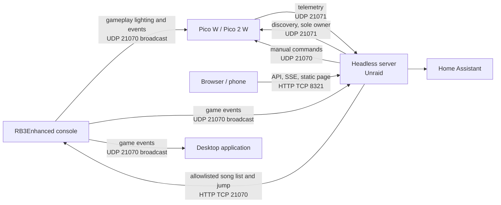

# Dashboard Stage Two Plan

> **For agentic workers:** Implement and review one task per commit. Stage 1 is complete at `f5133bb`; this plan starts from `037b274`.

**Goal:** Run the dashboard's reusable services as a headless LAN service on Unraid, expose a browser dashboard and HTTP API over it, and integrate Home Assistant, while the existing desktop application keeps working and console-to-Pico gameplay lighting stays direct.

**Architecture:** One headless process owns the RB3E listener, Pico discovery, the device registry, session persistence, and outbound integrations. A versioned in-memory state store feeds a stdlib HTTP server providing JSON endpoints, a server-sent event stream, and one static page. Tk, VLC, Discord IPC, and display control stay in the desktop process, which can run standalone as it does today or in an observe-only mode that consumes the server API.

**Tech stack:** Python, unittest, stdlib `http.server` and `sqlite3`, existing `requests`; optional server-only `paho-mqtt` for Home Assistant; Docker for Unraid packaging. No new runtime dependency in Tasks 1-13.

**Spec:** The user's September 12 Stage 2 instruction: headless runtime, worker/event boundaries, web API and browser dashboard, server configuration and persistence, Docker/Unraid deployment, Home Assistant integration, and separated creative extensions. Stage boundary and known limitations come from `docs/dashboard-architecture.md`.

## Upstream protocol findings

Verified against the RB3Enhanced source on 2026-09-12. These findings constrain the tasks below.

| Finding | Source | Consequence |
| --- | --- | --- |
| `RB3E_InitEvents()` defaults to `EventsIP = 255.255.255.255`, `EventsPort = 0x524E` (21070). | `source/net_events.c` | The server is additive. It can bind UDP 21070 alongside the desktop and the Picos without changing console configuration. |
| `[Events] BroadcastTarget` overrides both address and port, to a single destination. | `source/net_events.c`, `include/config.h` | Setting it to one host silences every other receiver. Pointing it at the server would stop gameplay lighting reaching the Picos. It must stay empty or hold a broadcast address. |
| `[Events] SendStagekit` is a separate flag from `EnableEvents`. | `include/config.h` | Stage Kit events require their own opt-in. Belongs in troubleshooting documentation. |
| `[HTTP] AllowCORS` is zero-initialised, so it defaults off. | `include/config.h`, `source/config.c` | A browser page cannot call the console directly. All console HTTP must be proxied by the server. |
| The console serves `/`, `/song_<id>`, `/list_songs`, `/jump?shortname=`, `/jsonrpc`, and `/execute?script=`. | `source/net_http_server.c` | `/execute` runs DTA script on the console. The proxy must be an explicit allowlist of `/list_songs` and `/jump`, never a pass-through. |
| Event enum is unvalued and sequential 0-10; `SCORE` is 21 bytes, `STAGEKIT` 2, `BAND_INFO` 12, `DX_DATA` (`RB3E_EventModData`) 250. | `include/net_events.h` | `rb3dashboard.protocol` is correct except that `DX_DATA` is missing from `_MIN_PAYLOAD_SIZES` and is therefore dropped. |
| `PacketSize` is one byte; payloads are capped at `RB3E_EVENTS_MAXPACKET`. | `include/net_events.h` | The existing `>IBBBB` header unpack is right. |

Multi-byte fields are big-endian because the console targets are PowerPC. This is consistent with the existing parser but is unverified for any x86 path.

## Runtime topology

Gameplay lighting never passes through the server.

## Discovery ownership

`firmware/src/network.c` stores exactly one `dashboard_addr`, overwrites it on every received discovery packet, unicasts telemetry there, and reverts to broadcast only after `DISCOVERY_TIMEOUT_MS` (30 s) without discovery. The desktop broadcasts discovery every 5 s.

Two concurrent discovery senders therefore make each Pico alternate its telemetry destination, so neither observer holds a stable device list. Exactly one process may send discovery. The server takes that role; the desktop's observe-only mode stops sending discovery and reads device state from the API instead. Defaults preserve today's standalone desktop behaviour.

## Global constraints

- Continue the local `main` commit sequence. Do not push, deploy, or contact live devices or firmware.
- Commit author: `idio-sync <jedivoodoo@gmail.com>`.
- Preserve UDP 21070 and 21071 wire bytes, desktop settings and cache locations and formats, existing UI controls, and the `python Dashboard/dashboard.py` entry point.
- TCP 21070 belongs to the console. The dashboard web server uses a separate configurable port, default 8321.
- Keep Python 3.8-compatible application and test syntax. CI and the container use 3.11.
- Add no runtime dependency in Tasks 1-13. Task 14's `paho-mqtt` is optional and server-only.
- The server process must not import Tk, VLC, `pypresence`, or `screeninfo`.
- Tests use fake sockets, fake HTTP, and temporary directories. No test contacts a real device or external service.
- Before each code commit: covering tests, the full suite when integration changes warrant it, independent review, and `git diff --cached --check`.

## Completion criteria

- A headless entry point starts and stops the listener, discovery, state, persistence, and HTTP services in a defined order, responds to SIGINT and SIGTERM, and imports no desktop-only module.
- Every worker queue has an explicit capacity and a counted drop or rejection policy; stale work is cancelled on stop; integration failures cannot block the receive path.
- The HTTP API serves current state, device health, and song data, streams live updates, and requires a token for any state-changing route.
- A browser page shows now playing, device health, manual lighting, and recent log lines without a build step.
- Server configuration is explicit about every bind address, broadcast target, port, data directory, and token. No value is inferred from a default route.
- The desktop still runs standalone with unchanged defaults, and can additionally run observe-only against the server.
- A container image and Unraid deployment notes exist, with a health check, a persistent appdata mapping, and documented network-mode requirements.
- Home Assistant integration is documented and implemented with explicit ownership and availability behaviour.
- Documentation records what was validated and what was not. Hardware, live-service, and Unraid runtime behaviour are not claimed without evidence.

## Task 1: Add a bounded headless event dispatcher

**Files:** Create `Dashboard/rb3dashboard/runtime/__init__.py`, `Dashboard/rb3dashboard/runtime/dispatch.py`, `Dashboard/tests/test_runtime_dispatch.py`.

**Interface:** `HeadlessDispatcher(capacity=..., on_drop=None)` exposes `post(callback, *args) -> bool`, `start()`, `close()`, and a counters accessor. It owns one drain thread, holds no Tk reference, and mirrors `UiDispatcher`'s accept/reject contract.

- [x] Test acceptance and ordering, rejection after close, capacity enforcement with a counted drop policy, callback exception isolation, bounded join on close, and posting from multiple worker threads.
- [x] Implement the dispatcher with an explicit capacity and drop accounting; the architecture document records the unbounded Stage 1 deque as a known gap.
- [x] Verify by subprocess import test that the module imports no Tk.
- [x] Run the full suite, review, commit `feat: add bounded headless event dispatcher`.

## Task 2: Accept RB3E mod data events

**Files:** `Dashboard/rb3dashboard/protocol.py`, `Dashboard/tests/` protocol coverage.

- [x] Add `RB3E_EVENT_DX_DATA` to `_MIN_PAYLOAD_SIZES` with its upstream 250-byte payload, and test that valid mod data parses while truncated and malformed packets are still rejected.
- [x] Confirm no existing consumer changes behaviour when the event becomes visible.
- [x] Run the suite, review, commit `feat: accept RB3E mod data events`.

## Task 3: Add shared headless application state

**Files:** Create `Dashboard/rb3dashboard/runtime/state.py` and its tests.

**Interface:** A thread-safe store holding game, session, device, and bounded log state, returning immutable versioned snapshots so polling and streaming clients can detect change.

- [x] Test concurrent updates, monotonic versioning, snapshot immutability, and log ring bounding.
- [x] Keep the module free of I/O, sockets, and timing dependencies.
- [x] Run the suite, review, commit `feat: add shared headless application state`.

## Task 4: Add the headless service supervisor and entry point

**Files:** Create `Dashboard/rb3server.py`, `Dashboard/rb3dashboard/runtime/supervisor.py`, and lifecycle tests.

- [x] Test ordered startup, ordered shutdown, partial-start rollback, idempotent stop, and signal handling with fake services.
- [x] Add a subprocess import-boundary test, in the style of `tests/test_import.py`, asserting the server entry point imports no Tk, VLC, `pypresence`, or `screeninfo` and opens no socket on import.
- [x] Wire the real listener and Stage Kit transport through the headless dispatcher into application state.
- [x] Run the suite, review, commit `feat: add headless service supervisor and entry point`.

## Task 5: Add explicit server configuration

**Files:** Create `Dashboard/rb3dashboard/runtime/config.py` and tests.

- [x] Support environment variables and a JSON file for bind addresses, broadcast targets, ports, data directory, token, and feature flags, with validation and actionable errors.
- [x] Leave the desktop `SettingsStore` and its paths untouched.
- [x] Run the suite, review, commit `feat: add explicit server configuration`.

## Task 6: Own Pico discovery in the headless service

**Files:** `Dashboard/rb3dashboard/runtime/`, Stage Kit transport configuration, tests.

- [x] Replace the inferred `/24` broadcast with a configured list of broadcast targets, keeping the existing five-second cadence and packet bytes.
- [x] Maintain a device registry with last-seen, availability, and a documented offline threshold; test expiry and recovery with a fake clock.
- [x] Document and test single-owner enforcement so a second sender is a configuration choice, not an accident.
- [x] Run the suite, review, commit `feat: own Pico discovery in the headless service`.

## Task 7: Add the read-only HTTP API and event stream

**Files:** Create `Dashboard/rb3dashboard/runtime/web/` and tests.

- [x] Serve `/api/health`, `/api/state`, `/api/devices`, and an `/api/events` SSE stream from a threading stdlib server bound to the configured address.
- [x] Require a bearer token for everything except health; test rejection, slow and disconnecting clients, and stream teardown on shutdown.
- [x] Run the suite, review, commit `feat: add read-only HTTP API and event stream`.

## Task 8: Proxy allowlisted console endpoints

**Files:** Server web modules, song browser wiring, tests.

- [x] Proxy only `/list_songs` and `/jump` server-side, because the console defaults to `AllowCORS` off. Reject every other console path; `/execute` must be unreachable through this service.
- [x] Test the allowlist, shortname encoding, console failure handling, and timeouts with a fake console.
- [x] Run the suite, review, commit `feat: proxy allowlisted console song endpoints`.

## Task 9: Add lighting command endpoints

**Files:** Server web modules, a scene definition module, tests.

- [x] Add authenticated command and named-scene endpoints that emit the existing Stage Kit command bytes to a selected device or broadcast, with rate limiting.
- [x] Never place the server in the gameplay lighting path; test that no console event triggers an outbound light command.
- [x] Run the suite, review, commit `feat: add lighting command endpoints`.

## Task 10: Add the browser dashboard

**Files:** Static assets served by the server, tests.

- [x] Provide one page with now playing, device health, manual lighting, and recent log lines, using the SSE stream with reconnect and no build step.
- [x] Test asset serving, content types, and path traversal rejection.
- [x] Run the suite, review, commit `feat: add browser dashboard`.

## Task 11: Persist server session history

**Files:** Server persistence module, tests.

- [x] Store sessions, songs, and device history in SQLite under the configured data directory, with schema versioning and a documented migration path.
- [x] Leave desktop JSON formats and locations unchanged; test against temporary directories only.
- [x] Run the suite, review, commit `feat: persist server session history`.

## Task 12: Add the outbound integration worker

**Files:** Server integration modules, listener webhook path, tests.

- [x] Move Home Assistant webhook delivery off per-event daemon threads onto one bounded worker with retry, drop accounting, and failure counters exposed through the API.
- [x] Guarantee that a failing or slow integration cannot block the UDP receive path; test with a hanging fake endpoint.
- [x] Run the suite, review, commit `feat: add outbound integration worker`.

## Task 13: Add desktop observe-only mode

**Files:** Desktop settings and lifecycle, optional event relay, tests.

- [x] Add a mode in which the desktop does not bind UDP 21070 or send discovery, and instead reads state and devices from the server API.
- [x] Add an opt-in server event relay for deployments that set `BroadcastTarget` to a single host, preserving packet bytes exactly.
- [x] Default settings must preserve current standalone behaviour; test that an existing settings file is unaffected.
- [x] Run the suite, review, commit `feat: add desktop observe-only mode`.

## Task 14: Package the server for Docker and Unraid

**Files:** `Dockerfile`, compose file, ignore files, build documentation.

- [x] Build a `python:3.11-slim` image running as a non-root user, with a health check against `/api/health` and an appdata volume for the data directory.
- [x] Document why host networking is the candidate mode for UDP broadcast and discovery, and that it is untested on real Unraid hardware.
- [x] Review, commit `build: add server container image and compose file`.

## Task 15: Add Home Assistant MQTT discovery

**Files:** Server integration modules, configuration, documentation, tests.

- [ ] Publish game, session, and device entities through MQTT discovery with retained config topics, availability and last-will behaviour, and explicit ownership on restart.
- [ ] Make `paho-mqtt` an optional server-only dependency that is absent by default; the existing webhook remains the zero-dependency option.
- [ ] Test against a fake broker client. Review, commit `feat: publish Home Assistant MQTT discovery`.

## Task 16: Document Stage 2 and validate

**Files:** README, `docs/dashboard-architecture.md`, this plan.

- [ ] Document server architecture, configuration, ports, deployment, access control, and the upstream protocol findings above, including the `BroadcastTarget` hazard, the `SendStagekit` flag, and why `/execute` is never proxied.
- [ ] Run the full suite and record results honestly. State explicitly that hardware, live-service, Unraid, and browser runtime behaviour were or were not validated.
- [ ] Record the commit history and remaining limitations. Review, commit `docs: document Stage 2 server architecture`.

## Deferred extensions

These are explicitly outside the first release and depend on Tasks 1-16.

| Extension | Dependency | First slice |
| --- | --- | --- |
| OBS overlay views | Tasks 7, 10 | Read-only transparent overlay routes with a scoped token. |
| Event recording and replay | Tasks 3, 11 | Timestamped validated events, including mod data, replayable without hardware. |
| Shared party controls | Tasks 9, 11 | Per-guest scoped tokens, a queue, and an action audit trail. |
| Lighting scene editor | Task 9 | Persisted user scenes built on the named-scene endpoint. |
| Device health history | Tasks 6, 11 | RSSI and availability retention with trend views. |
| Desktop companion | Task 13 | Discord Rich Presence and VLC driven from server events on the user's PC. |

## Starting point

Stage 1 complete at `f5133bb`, documented at `037b274`. 209 tests pass. The worktree was clean when Stage 2 planning began.
